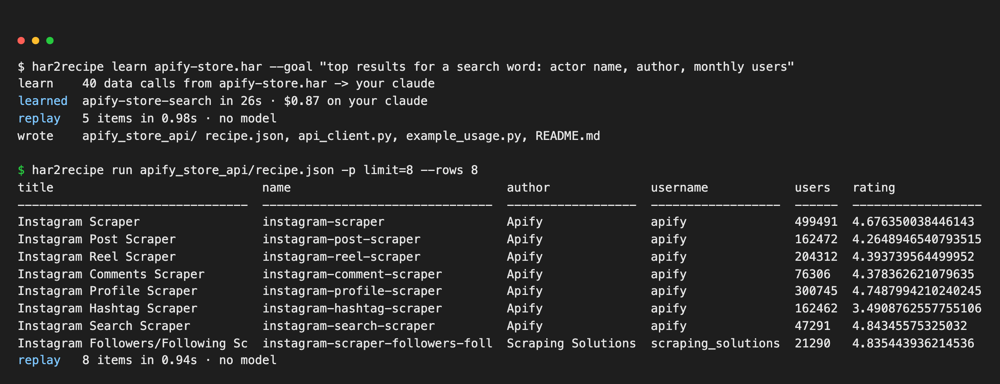

# har2recipe

**Browse a site once. Get its hidden API as a Python client, plus a recipe that replays in seconds with no model.**

**Guides:** [turn a HAR file into a Python API client, step by step](https://trungtin.github.io/har2recipe/guides/har-to-python-api-client/) · [all guides](https://trungtin.github.io/har2recipe/guides/)



## How it works

1. **Capture.** Open DevTools > Network on the page, do the thing you want data from, and export the HAR.
2. **Learn.** `har2recipe learn site.har --goal "..."` keeps only the JSON/XHR calls, blanks cookies, auth headers and key-like values, and asks *your own* `claude` to pick the endpoints.
3. **Check.** You get `api_client.py`, `example_usage.py`, `README.md` and `recipe.json`. learn replays the recipe once before it says done, and gives Claude one chance to fix a failing recipe.
4. **Replay.** `har2recipe run recipe.json` fetches fresh data with plain HTTP: no browser, no model, no tokens. When the site changes, `har2recipe verify` notices and re-learns from a fresh HAR.

Example goal: `"top 50 results for a search word: name, author, monthly users"`.

## Install

You need Python 3.9+ and [Claude Code](https://www.anthropic.com/claude-code), logged in, with `claude` on your PATH. har2recipe has no other dependencies.

```bash
uv tool install git+https://github.com/trungtin/har2recipe
# or
pipx install git+https://github.com/trungtin/har2recipe
```

For coding agents: copy `SKILL.md` to `~/.claude/skills/har2recipe/SKILL.md`, and the agent runs these steps for you.

## Quick start

```bash
har2recipe calls site.har                                   # see what will be sent (redacted)
har2recipe learn site.har --goal "newest 20 listings: title, price, url"
har2recipe run newest_20_listings_title_price_url_api/recipe.json
har2recipe run .../recipe.json -p query=shoes --format json > out.json
har2recipe verify .../recipe.json                           # cron this; exit 2 means stale
```

## Export a HAR

- **Chrome / Edge:** DevTools > Network, tick *Preserve log*, reload and do the action, then click the download arrow (*Export HAR*).
- **Firefox:** DevTools > Network, do the action, right-click a request > *Save All As HAR*.
- **Safari:** Web Inspector > Network, do the action, then *Export*.

Capture only the pages you need. Smaller HARs give better recipes.

## What you get

```
newest_20_listings_api/
  recipe.json        the replayable recipe (no model needed)
  api_client.py      a typed client, standard library only
  example_usage.py   runs the goal and prints 5 items
  README.md          the endpoints, params and env vars
```

## The recipe

```json
{
 "site": "example.com",
 "name": "search",
 "method": "http",
 "params": {"query": {"default": "shoes"}},
 "requests": [{"name": "search", "method": "GET",
               "url": "https://api.example.com/v1/search?q={query}",
               "headers": {"accept": "application/json", "authorization": "{env:EXAMPLE_TOKEN}"}}],
 "extract": {"items": "data.results", "fields": {"title": "name", "price": "price.amount"}},
 "check": {"min_items": 10, "required": ["title"]}
}
```

`{param}` takes a value from `-p key=value`. `{env:NAME}` reads an environment variable, so secrets never live in the file. `save` passes a value (a token, an id or a cursor) from one request to the next. `check` is what `verify` tests.

## When the site changes

Generated clients break silently when a site moves an endpoint. `verify` replays the recipe and checks the item count and the required fields. If they pass, it stamps `verified` in the recipe. If they fail, it exits 2 and tells you to capture again:

```bash
har2recipe verify my_api/recipe.json --har fresh.har   # re-learns into the same folder
```

## Caveats

- **HAR files hold your cookies and tokens.** learn blanks cookie, authorization and key-like headers and query values before anything reaches Claude. Request bodies, such as a login form, go as captured. Export only what you need, and never share a HAR.
- **Review generated code** before you run it.
- **Use it on data you are allowed to read**, and respect the site's terms and rate limits.
- Sites with heavy bot protection, signed requests or very short-lived tokens may not replay with plain HTTP.
- Public keys that a page sends on purpose (for example a public search key) can be kept with `--keep header-name`.

## Why we built it

Our agents read the same pages every day: marketplace listings, app stores, community feeds. Driving a browser for every read was slow and used model tokens each time. A recipe learned once and replayed with plain HTTP takes seconds and no tokens, and `verify` tells us the day it goes stale.

## Credits

Inspired by [reverse-api-engineer](https://github.com/kalil0321/reverse-api-engineer) (MIT), which generates API clients from captured browser traffic and is worth a look for its browser and agent modes. har2recipe is a separate, smaller tool built around replayable recipes and the stale check.

## License

MIT
